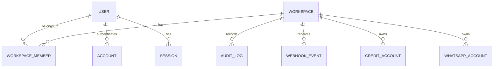

# Initial ERD

The foundation schema is not the complete product schema. Calls, messages, AI usage, ledger entries, and recordings will be added with their owning workspace and provider-event relationships in later milestones.
